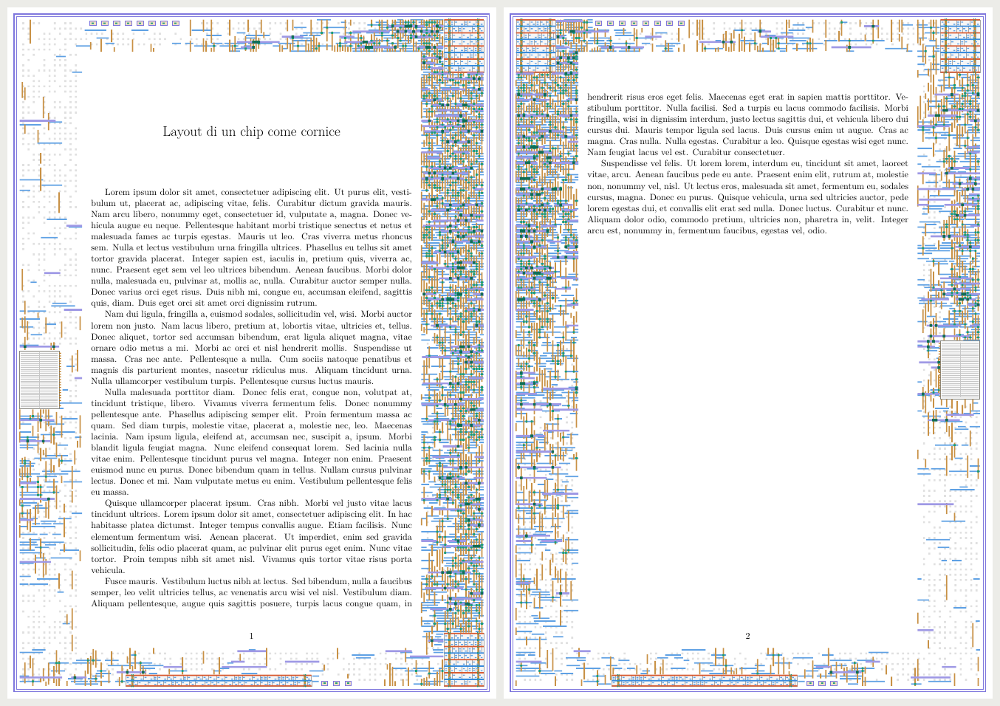
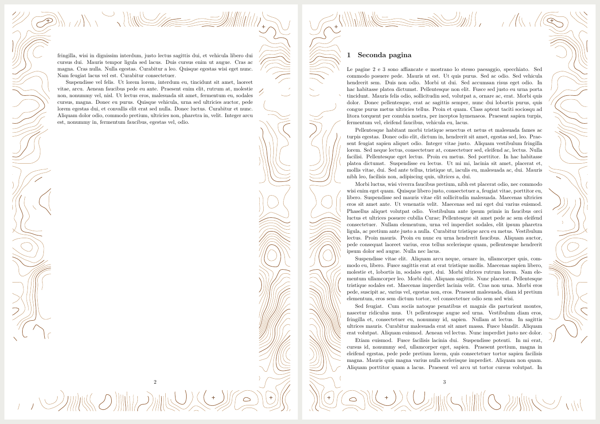
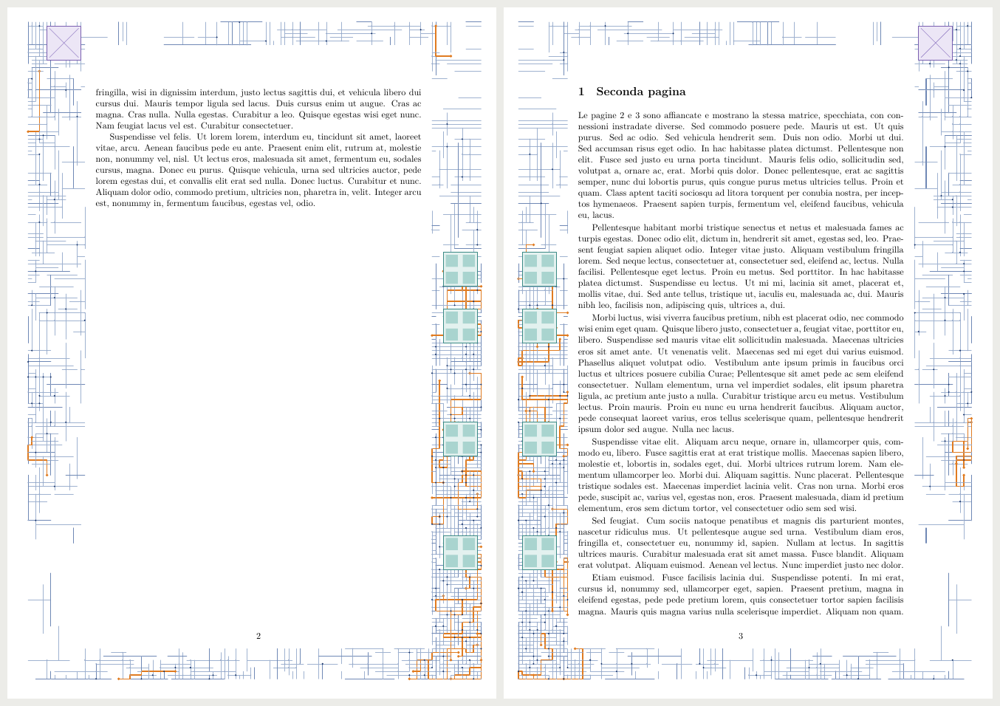

# Margini generativi per LuaLaTeX

[](https://github.com/giob22/templateLatex/actions/workflows/test.yml)

*Generative page margins for LuaLaTeX: a different drawing on every page, growing from the corners
towards the text and never touching it. One package per motif (chip layout, contour lines, more to
come), all with the same options. MIT licence.*

Pacchetti LuaLaTeX che disegnano il margine di ogni pagina con un motivo generato: un disegno diverso a
ogni pagina, asimmetrico, che cresce dagli angoli verso il testo e non lo tocca mai. Si usano con una riga
nel preambolo, e con `seed=` lo stesso documento dà sempre lo stesso risultato.





## Pacchetti

Uno per motivo, realizzati uno alla volta. I nomi di quelli ancora da fare sono provvisori.

| Pacchetto | Motivo | Stato | Anteprima |
|---|---|---|---|
| [`asicmargins`](asicmargins/) | layout di chip (celle, macro, tre metalli, via, pad) | v0.3 pronto | [immagine](docs/anteprima-asicmargins.png) |
| [`topomargins`](topomargins/) | curve di livello | v0.1 pronto | [immagine](docs/anteprima-topomargins.png) |
| `pcbmargins` | circuito stampato | da fare | [bozza](bozze/01-pcb.png) |
| `clockmargins` | albero di clock | da fare | [bozza](bozze/02-albero-di-clock.png) |
| [`fpgamargins`](fpgamargins/) | matrice di interconnessione FPGA | v0.1 pronto | [immagine](docs/anteprima-fpgamargins.png) |
| `timingmargins` | diagrammi temporali | da fare | [bozza](bozze/04-diagrammi-temporali.png) |
| `wafermargins` | wafer map | da fare | [bozza](bozze/05-wafer.png) |
| `rootmargins` | radici e vene | da fare | [bozza](bozze/07-radici.png) |
| `citymargins` | mappa stradale | da fare | [bozza](bozze/08-mappa-stradale.png) |

Panoramica di tutte le bozze: [bozze/panoramica.png](bozze/panoramica.png).

## Installazione

Serve **LuaLaTeX** (con `pdflatex` o `xelatex` il pacchetto si ferma con il messaggio «LuaTeX is required to
compile this document») e LaTeX 2022-06 o successivo.

Per usare un pacchetto servono quattro file: due del pacchetto e due del motore comune. Scarica la repo
(*Code → Download ZIP*) e copia `margincore/margincore.sty`, `margincore/margincore.lua` e i due file della
cartella del pacchetto scelto (per esempio `topomargins/topomargins.sty` e `topomargins/topomargins.lua`):

- **per un documento solo**: mettili nella stessa cartella del documento;
- **per tutti i documenti**: mettili in `tex/lualatex/margins/` dentro il tuo `texmf` personale
  (la cartella si trova con `kpsewhich -var-value TEXMFHOME`; su MiKTeX va aggiunta in *MiKTeX Console →
  Impostazioni → Directory*) e aggiorna l'indice dei file con `texhash` (TeX Live) o `initexmf --update-fndb`
  (MiKTeX).

In alternativa `python tools/release.py <pacchetto>` crea un archivio con i quattro file, il README e l'esempio.

## Uso

```latex
\documentclass{article}
\usepackage[a4paper,margin=3.6cm]{geometry}
\usepackage[seed=7, where={topleft,bottomright}, palette=ink]{topomargins}
\begin{document}
...
\end{document}
```

Compilare con `lualatex`. Passando da un pacchetto all'altro cambia solo il nome. Opzioni condivise:

| Opzione | Effetto |
|---|---|
| `seed` | Intero che fissa i margini; se manca se ne sceglie uno a caso, scritto nel `.log` |
| `where` | Dove disegnare: `top`, `bottom`, `sides`, `topleft`, `corners`, anche in elenco |
| `density`, `clear` | Quanto arriva lontano dagli angoli, e distanza minima dal testo |
| `twoside` | Fronte/retro: le pagine pari sono specchiate (`auto` segue la classe) |
| `autoscale` | Adatta il disegno al formato della pagina e ai margini |
| `halo` | Spazio libero attorno a numeri di pagina, testatine e note a margine |

Ogni pacchetto aggiunge le sue opzioni (`palette`, ecc.), descritte nel suo README. Per provarne molte
insieme, in `prova/` ci sono `configurazioni.tex` e `configurazioni-topo.tex`: righe commentate da
decommentare una per volta.

## Compatibilità

I test girano in automatico (GitHub Actions) con TeX Live 2023 e con la versione più recente, e a mano con
MiKTeX. Con `pdflatex` o `xelatex` non funziona: il disegno è calcolato in Lua.

## Struttura della repo

| Cartella | Contenuto |
|---|---|
| [`margincore/`](margincore/) | il motore comune: seme, zone `where`, alone, densità, fronte/retro, scala. Il suo README spiega come si scrive un nuovo motivo |
| `asicmargins/`, `topomargins/`, `fpgamargins/` | un pacchetto per cartella: `.sty`, `.lua`, README, esempio, `test/` |
| [`tools/`](tools/) | `testlib.lua` (parti comuni dei test), `release.py` (archivio di rilascio), `try_all.py` (prova tutte le configurazioni di un file) |
| `bozze/` | bozze dei motivi, in Python (servono `numpy` e `Pillow`) |
| `docs/` | le anteprime di questo README |
| `prova/` | prove a mano |

Ogni motivo è solo un generatore di elementi (un file Lua) che gira sopra il motore: un pacchetto nuovo sono
due file piccoli più i test.

## Contribuire

Segnalazioni e proposte sono benvenute: vedi [CONTRIBUTING.md](CONTRIBUTING.md).

## Licenza e crediti

Codice, documentazione e immagini di questa repo sono rilasciati con licenza [MIT](LICENSE): si possono usare,
modificare e ridistribuire, anche in progetti commerciali, mantenendo l'avviso di copyright. Il software è
fornito «così com'è», senza garanzie.

- **Flora.** L'idea nasce da [Flora](https://flora.alpacasoft.dev), che disegna margini floreali. Questo progetto
  è indipendente e non affiliato a Flora, e non contiene suo codice, grafica o altro materiale.
- **Font nei PDF d'esempio.** Usano Latin Modern (GUST Font License), che ne permette l'incorporamento e la
  ridistribuzione.
- **Testo segnaposto.** Il testo degli esempi viene dal pacchetto `lipsum`.
- **Strumenti.** Gli script in `bozze/` e `tools/` usano Python con `numpy` e `Pillow`, che non sono inclusi.

Autore: [giob22](https://github.com/giob22).
